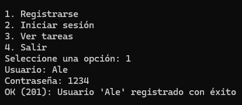
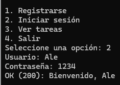
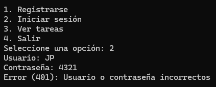
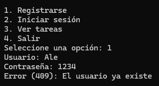
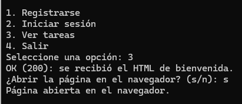
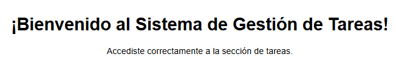
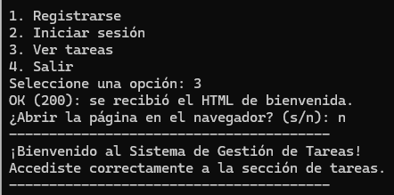

# PFO 2: Sistema de Gestión de Tareas con API y Base de Datos

Trabajo práctico de Programación sobre Redes. Es una API REST hecha con Flask y SQLite, que sigue la arquitectura cliente-servidor vista en clase: el cliente (consola) envía solicitudes HTTP y el servidor las procesa, guarda los datos y devuelve una respuesta.

## Contenido

- `servidor.py`: API Flask con SQLite.
- `cliente.py`: cliente en consola para probar la API.
- `index.html`: documentación para GitHub Pages.
- `requirements.txt`: librerías necesarias.

## Cómo ejecutar

1. Instalar las librerías:

```bash
pip install -r requirements.txt
```

2. Iniciar el servidor (terminal 1):

```bash
python servidor.py
```

3. Iniciar el cliente (terminal 2):

```bash
python cliente.py
```

La base de datos `usuarios.db` se crea sola la primera vez que se ejecuta el servidor.

## Endpoints

| Método | Ruta        | Descripción                                              |
|--------|-------------|----------------------------------------------------------|
| POST   | `/registro` | Registra un usuario (la contraseña se guarda hasheada)   |
| POST   | `/login`    | Verifica las credenciales e inicia la sesión             |
| GET    | `/tareas`   | Muestra un HTML de bienvenida (solo si hay login)        |

## Cómo probarlo

Con el cliente en consola:

1. Opción 1: registrar un usuario y una contraseña.
2. Opción 2: iniciar sesión con los mismos datos.
3. Opción 3: ver el mensaje de bienvenida de `/tareas` (requiere login).

También se puede probar con `curl` (el archivo `cookies.txt` guarda la sesión):

```bash
curl -X POST http://localhost:5000/registro -H "Content-Type: application/json" -d '{"usuario": "juan", "contraseña": "1234"}'

curl -X POST http://localhost:5000/login -H "Content-Type: application/json" -d '{"usuario": "juan", "contraseña": "1234"}' -c cookies.txt

curl http://localhost:5000/tareas -b cookies.txt
```

Respuestas esperadas:

- Registro correcto: `201`.
- Usuario repetido: `409`.
- Login correcto: `200`. Con datos incorrectos: `401`.
- `/tareas` sin haber iniciado sesión: `401`.

## Capturas de pantalla















## Respuestas conceptuales

### ¿Por qué hashear contraseñas?

Porque no es seguro guardar las contraseñas en texto plano: si alguien accede a la base de datos, podría leerlas todas. El hash convierte la contraseña en un texto que no se puede revertir, así que aunque se filtre la base de datos no se conocen las contraseñas originales. Al iniciar sesión, el servidor hashea la contraseña ingresada y la compara con el hash guardado. Esto se relaciona con lo visto en clase sobre la seguridad en el servidor, que protege los datos y controla el acceso mediante autenticación y autorización.

### Ventajas de usar SQLite en este proyecto

- No hace falta instalar ni configurar un servidor de base de datos: todo se guarda en un solo archivo.
- Viene incluido en Python (módulo `sqlite3`), no requiere librerías extra.
- Los datos persisten aunque se apague el servidor, a diferencia de guardarlos en memoria como hicimos con las notas.
- Es simple y suficiente para un proyecto chico como este.

## GitHub Pages

Flask no puede ejecutarse en GitHub Pages porque solo aloja páginas estáticas. Por eso se usa Pages para publicar la documentación del proyecto (`index.html` y las capturas), mientras que el servidor se ejecuta de forma local.
